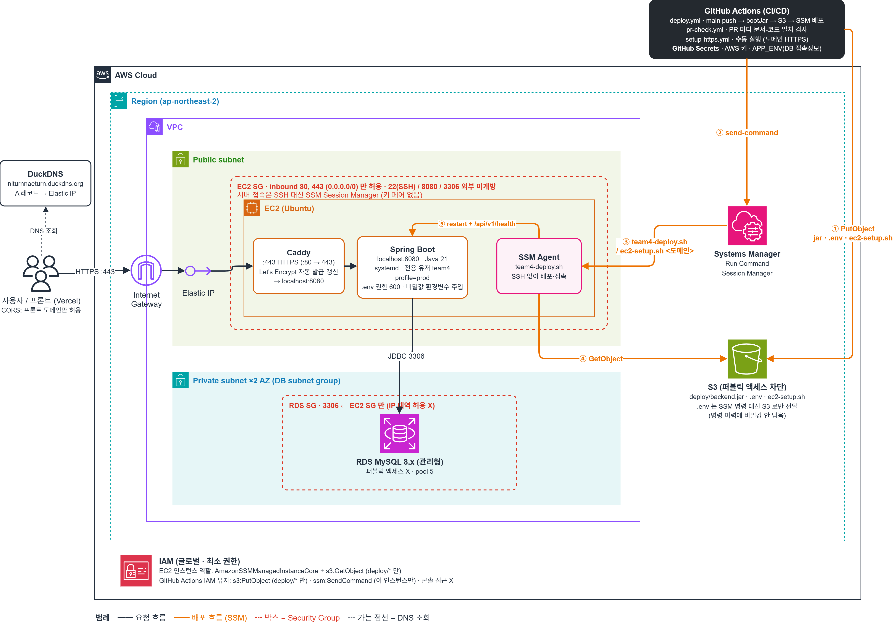
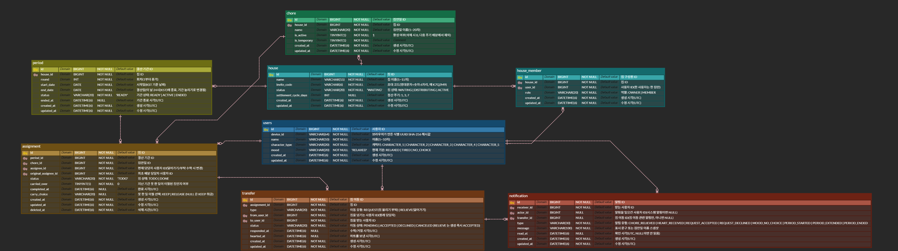

<div align="center">

# 🏠 team-4-backend

**CMC 11기 해커톤 4조 백엔드**<br>
집안일을 나누고, 덜어주고, 고마움을 하트로 전하는 서비스의 API 서버


[운영 API](https://niturnnaeturn.duckdns.org) · [Swagger](https://niturnnaeturn.duckdns.org/swagger-ui/index.html) · [프론트엔드](https://team-4-frontend-bice.vercel.app)

</div>

---

## 📌 한눈에 보기

| 항목 | 값 |
| --- | --- |
| 운영 API | `https://niturnnaeturn.duckdns.org` |
| Swagger | `https://niturnnaeturn.duckdns.org/swagger-ui/index.html` |
| 헬스 체크 | `GET /api/v1/health` |
| 프론트 (CORS 허용) | `https://team-4-frontend-bice.vercel.app`, Vercel 프리뷰 `https://team-4-frontend-*.vercel.app`, 로컬 `http://localhost:5173` |

## 🛠 기술 스택

| 분류 | 사용 기술 |
| --- | --- |
| Language / Framework | Java 21, Spring Boot 4.1.3, Spring Data JPA, Lombok |
| Database | MySQL 8.x (운영 RDS, 로컬 Docker), H2 (테스트) |
| API 문서 | springdoc-openapi (Swagger UI) |
| Infra | AWS EC2 (Ubuntu), RDS, S3, Systems Manager, Elastic IP, DuckDNS |
| Web Server | Caddy (Let's Encrypt 자동 HTTPS) |
| CI/CD | GitHub Actions → S3 → SSM Run Command |
| Code Style | Spotless |

## 🏗 시스템 아키텍처

<p align="center">
  
</p>

- **요청 흐름**: 사용자 → Caddy(`:443`, HTTPS 종료) → Spring Boot(`localhost:8080`) → RDS MySQL (Private subnet)
- **배포 흐름**: ① Actions 가 jar·`.env` 를 S3 에 업로드 → ② SSM `send-command` → ③ EC2 의 SSM Agent 가 team4-deploy.sh 실행 → ④ S3 에서 받아오기 → ⑤ systemd 재시작 후 `/api/v1/health` 확인
- **보안**: 22(SSH)·8080·3306 은 외부에 열지 않고 서버 접속은 SSM Session Manager 로만 한다. RDS 는 EC2 SG 에서 오는 요청만 받는다. IAM 은 최소 권한

자세한 구성은 [docs/architecture.md](docs/architecture.md), 결정 이유는 [docs/adr/](docs/adr/README.md).

## 🗂 ERD

<p align="center">
  
</p>

| 테이블 | 설명 |
| --- | --- |
| `users` | 기기 식별(device_id SHA-256 해시)로 가입한 사용자. 캐릭터·현재 기분 |
| `house` / `house_member` | 집과 구성원. 초대 코드로 참여, OWNER / MEMBER 역할 |
| `chore` | 집안일 목록. 비활성화 시 다음 주기 배분에서 제외 |
| `period` | 결산 기간(회차). READY → ACTIVE → ENDED |
| `assignment` | 기간별 집안일 배분. 담당자·완료 여부·이월 선택 |
| `transfer` | 집안일 주고받기. 부탁(REQUEST) / 덜어가기(RELIEVE), 하트 |
| `notification` | 알림 (덜어가기, 하트, 부탁 수락·거절, 기간 시작·종료 등) |

## 🚀 빠른 시작 (로컬)

```bash
docker compose up -d          # MySQL(3307)
cp .env.example .env          # 선택: 없으면 기본값으로 동작
./gradlew bootRun             # http://localhost:8080/swagger-ui/index.html
```

자세한 내용은 [docs/local-dev.md](docs/local-dev.md).

## 📦 배포 요약

`main` 에 머지(push)되면 **즉시 운영에 배포**된다 (`.github/workflows/deploy.yml`).

```
머지 → Actions: bootJar → S3(deploy/backend.jar, deploy/.env) → SSM send-command
     → EC2: /usr/local/bin/team4-deploy.sh (S3 에서 받기 → systemd 재시작 → 헬스 체크)
사용자 → Caddy (https://niturnnaeturn.duckdns.org :443) → localhost:8080 (Spring Boot) → RDS(MySQL)
```

서버 세팅, Secrets, HTTPS, 디버깅은 [docs/deploy.md](docs/deploy.md).

## 📁 디렉터리 구조

도메인을 먼저 나누고, 그 안에서 계층별로 나눈다 ([ADR 0007](docs/adr/0007-domain-then-layer-packages.md)).

```
com/cmc/hackathon4/
├── domain/
│   ├── user/  house/  chore/  period/
│   ├── assignment/  transfer/  notification/  health/
│   └── {도메인}/
│       ├── controller/   XxxController, XxxApiDocs
│       ├── service/      XxxService
│       ├── repository/   XxxRepository
│       ├── entity/       Xxx
│       ├── converter/    XxxConverter
│       └── dto/          XxxCreateRequest, XxxUpdateRequest, XxxResponse
└── global/               auth/, config/, entity/, exception/, response/, swagger/
```

## 📚 문서

| 문서 | 내용 |
| --- | --- |
| [AGENTS.md](AGENTS.md) | 코드 규칙 (사람·에이전트 공통). `CLAUDE.md` 는 이 파일을 불러온다 |
| [CONTRIBUTING.md](CONTRIBUTING.md) | 브랜치·커밋·PR 규칙 |
| [docs/architecture.md](docs/architecture.md) | 구성 요소, 요청 흐름, 디렉터리 구조(도메인 분리), 설정 파일 역할 |
| [docs/local-dev.md](docs/local-dev.md) | 로컬 개발 환경 |
| [docs/deploy.md](docs/deploy.md) | 운영 배포·서버 세팅·HTTPS·디버깅 런북 |
| [docs/adr/](docs/adr/README.md) | 설계 결정 기록 (왜 그렇게 했는지) |

문서와 코드가 어긋나지 않았는지는 `bash scripts/check-docs.sh` 로 확인한다. PR 을 올리면 같은 검사가 자동으로 돈다 (`.github/workflows/pr-check.yml`).
